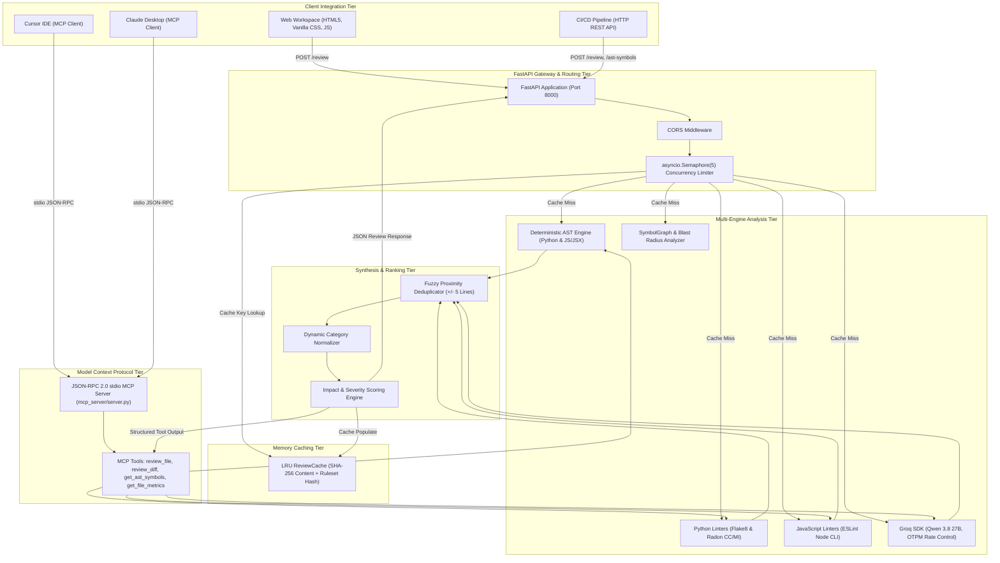
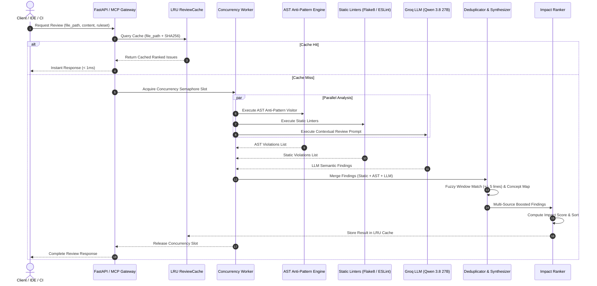

# Code Review Assistant: High-Performance Static, AST, and LLM Analysis Platform

A production-grade, multi-stage code review engine combining deterministic Abstract Syntax Tree (AST) pattern detection, traditional static analysis linters, and Large Language Model (LLM) reasoning. The platform features an in-memory SHA-256 LRU cache, an asynchronous concurrent file-processing pipeline, a fuzzy multi-source deduplication and ranking protocol, and a native Model Context Protocol (MCP) server for IDE integration.

---

## Table of Contents

- [1. System Architecture](#1-system-architecture)
  - [Architectural Philosophy](#architectural-philosophy)
  - [High-Level Tiered Architecture](#high-level-tiered-architecture)
  - [Subsystem Decomposition](#subsystem-decomposition)
- [2. Multi-Stage Review Engine](#2-multi-stage-review-engine)
  - [Pipeline Execution Flow](#pipeline-execution-flow)
  - [Deterministic AST Anti-Pattern Engine](#deterministic-ast-anti-pattern-engine)
  - [Symbol Graph and Code Blast-Radius Analysis](#symbol-graph-and-code-blast-radius-analysis)
  - [Traditional Static Analysis Linters](#traditional-static-analysis-linters)
  - [LLM Semantic Reasoning Tier](#llm-semantic-reasoning-tier)
- [3. Deduplication, Multi-Source Synthesis, and Ranking](#3-deduplication-multi-source-synthesis-and-ranking)
  - [The Multi-Source Collision Problem](#the-multi-source-collision-problem)
  - [Fuzzy Line Proximity Clustering](#fuzzy-line-proximity-clustering)
  - [Dynamic Category and Rule Normalization](#dynamic-category-and-rule-normalization)
  - [Multi-Source Confidence Synthesis](#multi-source-confidence-synthesis)
  - [Impact Scoring and Severity Prioritization](#impact-scoring-and-severity-prioritization)
- [4. Performance, Caching, and Concurrency](#4-performance-caching-and-concurrency)
  - [In-Memory LRU Content Cache](#in-memory-lru-content-cache)
  - [Asynchronous Worker Concurrency](#asynchronous-worker-concurrency)
- [5. Model Context Protocol (MCP) Server](#5-model-context-protocol-mcp-server)
  - [JSON-RPC 2.0 stdio Transport Protocol](#json-rpc-20-stdio-transport-protocol)
  - [Exposed Tool Catalog](#exposed-tool-catalog)
  - [Unified Git Diff Review Strategy](#unified-git-diff-review-strategy)
  - [Client Configurations (Claude Desktop and Cursor IDE)](#client-configurations-claude-desktop-and-cursor-ide)
- [6. Empirical Benchmark and Evaluation Results](#6-empirical-benchmark-and-evaluation-results)
  - [Benchmark Methodology](#benchmark-methodology)
  - [Evaluation Formulas](#evaluation-formulas)
  - [Overall Benchmark Performance](#overall-benchmark-performance)
  - [Performance by Defect Category](#performance-by-defect-category)
  - [Performance by Defect Severity](#performance-by-defect-severity)
  - [File-by-File Detection Breakdown](#file-by-file-detection-breakdown)
- [7. Complete REST API Reference](#7-complete-rest-api-reference)
  - [Core Review and Inspection Endpoints](#core-review-and-inspection-endpoints)
  - [Ingestion Endpoints](#ingestion-endpoints)
  - [Export Endpoints](#export-endpoints)
  - [Cache and Health Management](#cache-and-health-management)
- [8. Installation, Local Setup, and Verification](#8-installation-local-setup-and-verification)
  - [Prerequisites](#prerequisites)
  - [Environment Configuration](#environment-configuration)
  - [Step-by-Step Installation](#step-by-step-installation)
  - [Test Suite Execution](#test-suite-execution)

---

## 1. System Architecture

### Architectural Philosophy

The Code Review Assistant is engineered to eliminate the fundamental trade-off between deterministic precision and contextual depth:
- **Zero-Latency Determinism:** Structural flaws, syntax errors, security anti-patterns (such as hardcoded secrets, weak hashing, and SQL string concatenation), and lint violations must be flagged deterministically without token consumption or model latency.
- **Contextual Reasoning:** Semantic flaws, design discrepancies, logic subtleties, and architectural misuse require generative model reasoning with strictly enforced output schemas.
- **Harmonized Synthesis:** Overlapping detections across linters, AST rules, and language models must be consolidated into unified, high-confidence findings with actionable remediation snippets rather than duplicate complaints.

### High-Level Tiered Architecture



### Subsystem Decomposition

1. **FastAPI Application Gateway (`backend/main.py`):** Provides high-throughput asynchronous endpoints for file reviews, Git repository cloning, ZIP archive ingestion, AST inspection, blast-radius queries, unified diff patches, and GitHub PR review comment generation.
2. **Deterministic AST Anti-Pattern Engine (`backend/analysis/ast_engine.py`):** Custom node visitor traversing Python `ast` syntax trees and regex-based token inspection for JavaScript/JSX to catch critical syntax, security, and React anti-patterns with 100% precision.
3. **Static Linter Adapters (`backend/analysis/python_static.py`, `backend/analysis/javascript_static.py`):** Programmatic harnesses wrapping `flake8`, `radon` (cyclomatic complexity and maintainability index), and `eslint` for ecosystem standard compliance.
4. **LLM Reviewer Tier (`backend/llm/reviewer.py`):** Invokes Groq's `qwen/qwen3.8-27b` model with temperature 0, strict JSON schema validation, output token budgets (`max_tokens=800`), exponential backoff retries, and ruleset-guided system prompts.
5. **Deduplication and Synthesis Engine (`backend/reviews/deduplicator.py`):** Clustered fuzzy line matching, rule normalization, and multi-source confidence boost algorithms.
6. **In-Memory Cache Subsystem (`backend/reviews/cache.py`):** Thread-safe LRU cache storing review findings keyed by combined file paths and cryptographic SHA-256 payload hashes.
7. **Model Context Protocol Server (`mcp_server/`):** Standalone JSON-RPC 2.0 stdio server compliant with the MCP specification, enabling AI coding assistants to run file reviews, analyze diffs, extract AST symbols, and retrieve code metrics directly in their development environments.

---

## 2. Multi-Stage Review Engine

### Pipeline Execution Flow



### Deterministic AST Anti-Pattern Engine

The AST engine operates on concrete syntax trees rather than heuristic text matching. It flags anti-patterns that represent objective defects:

#### Python AST Analysis (`PythonASTVisitor`)
- **Bare `except:` Clauses (`AST-BARE-EXCEPT`):** Traverses `ast.ExceptHandler`. Detects `except:` statements missing a specific exception type. Catches silent failures that swallow system signals (`KeyboardInterrupt`, `SystemExit`).
- **Mutable Default Arguments (`AST-MUTABLE-DEFAULT`):** Traverses `ast.FunctionDef` and `ast.AsyncFunctionDef` defaults. Identifies `ast.List`, `ast.Dict`, and `ast.Set` literals used in function signatures, preventing state leakages across multiple invocations.
- **Arbitrary Code Execution (`AST-CODE-INJECTION`):** Detects invocations of `eval()`, `exec()`, and `compile()` containing non-literal arguments (`ast.Name`, `ast.Call`, `ast.JoinedStr`), eliminating arbitrary code execution vulnerabilities.
- **SQL String Concatenation (`AST-SQL-INJECTION`):** Inspects binary operations (`ast.BinOp` with `ast.Add`) and formatted string literals (`ast.JoinedStr`) that construct SQL statements (`SELECT`, `INSERT`, `UPDATE`, `DELETE`) with dynamic variables, enforcing parameterized queries.
- **Cryptographic Weak Hashing (`AST-WEAK-HASH`):** Inspects `ast.Call` nodes to `hashlib.md5()`, `hashlib.sha1()`, or module aliases. Enforces cryptographically sound hashing algorithms (`bcrypt`, `argon2`, `hashlib.pbkdf2_hmac`).
- **Hardcoded Secret Detection (`AST-HARDCODED-SECRET`):** Analyzes `ast.Assign` nodes where variable names match credential patterns (`password`, `secret`, `api_key`, `token`) assigned to string literals exceeding minimum length constraints.
- **Type Comparison with `type()` (`AST-TYPE-COMPARE`):** Traverses `ast.Compare` nodes checking equality (`==` or `!=`) against raw types (e.g., `type(x) == int`). Recommends `isinstance()` to preserve polymorphism and inheritance support.
- **Loop String Concatenation (`AST-STR-CONCAT-LOOP`):** Identifies variables in `for` and `while` loop bodies undergoing repetitive string accumulation (`s += item`), recommending `str.join()` to eliminate $O(N^2)$ memory reallocation.

#### JavaScript / JSX Analysis (`JavaScriptASTVisitor`)
- **`var` Scope Pollution (`AST-JS-VAR`):** Detects usage of `var` declarations, enforcing block-scoped `let` or immutable `const`.
- **Cross-Site Scripting via `innerHTML` (`AST-JS-XSS`):** Identifies dangerous DOM manipulations including direct `innerHTML` assignments and React's `dangerouslySetInnerHTML` attribute without sanitization.
- **Conditional React Hooks (`AST-JS-HOOK`):** Analyzes control-flow branches (if statements, loops, early returns) containing hook invocations (`useState`, `useEffect`, `useContext`, `useCallback`, `useMemo`). Flags violations of the Rules of Hooks.
- **Loose Equality Operators (`AST-JS-LOOSE-EQ`):** Detects comparison expressions using `==` and `!=` instead of strict identity operators `===` and `!==`.
- **Missing Semicolons (`AST-JS-SEMI`):** Accurately flags missing statement-terminating semicolons, stripping trailing inline comments (`// ...`) prior to end-of-line verification to avoid false negatives.

### Symbol Graph and Code Blast-Radius Analysis

The AST engine builds an interconnected dependency graph (`SymbolGraph`) across repository source files:
- **Symbol Indexing:** Functions, classes, and methods are recorded with file location, line boundaries, argument signatures, and calculated cyclomatic complexity.
- **Import Edges:** Explicit import statements (`import foo`, `from bar import baz`, `require('./module')`) are resolved into directional dependency edges.
- **Blast Radius Query:** Given a modified symbol or file, the graph traverses upstream references via breadth-first search (BFS) up to a configurable depth limit. This identifies every external function, route handler, or module directly or indirectly affected by changes to that symbol.

### Traditional Static Analysis Linters

The platform integrates standard industry linters to validate style, formatting, and complexity:
- **Flake8:** Enforces PEP 8 compliance, catches undefined variables (`F821`), unused imports (`F401`), and syntax anomalies.
- **Radon:** Measures Cyclomatic Complexity (McCabe metric) and Maintainability Index (MI) for Python modules.
- **ESLint:** Executes via local Node CLI integration to enforce JavaScript and React best practices. CommonJS globals (`module`, `exports`, `require`) are filtered to prevent false positive `no-undef` violations.

### LLM Semantic Reasoning Tier

Generative code reviews are handled through Groq's high-speed inference engine using the `qwen/qwen3.8-27b` model:
- **Zero Temperature:** Ensures deterministic, reproducible review outputs.
- **Token Protection and Conciseness:** To comply with on-demand rate limits (1,000 output tokens per minute), the system injects strict prompt constraints:
  - System prompts enforce single-sentence issue descriptions (maximum 15 words).
  - Code snippets and proposed fixes are constrained to minimal necessary blocks.
  - LLM completion queries enforce `max_tokens=800`, ensuring responses complete within 300 to 500 tokens.
- **Ruleset Context Injection:** When a specific ruleset is activated (e.g., `pep8`, `owasp_top_10`, `react_hooks`), only the rules belonging to that ruleset are injected into the LLM system prompt, focusing the model's attention on specified requirements.

---

## 3. Deduplication, Multi-Source Synthesis, and Ranking

### The Multi-Source Collision Problem

When combining deterministic AST rules, linters, and LLMs, identical defects are routinely identified by multiple tools with varying descriptions:
- A hardcoded password on line 8 might be flagged as `S105` by a linter, `AST-HARDCODED-SECRET` by the AST engine, and categorized as a high-severity security flaw by the LLM.
- Presenting all three as separate issues overwhelms developers and artificially inflates defect counts.

### Fuzzy Line Proximity Clustering

The deduplicator replaces exact line matching with a fuzzy proximity window algorithm:

$$\Delta_{\text{line}} = |L_A - L_B| \le \text{tolerance}$$

- **Standard Window:** Findings targeting the same file whose lines fall within a window of $\pm 5$ lines are evaluated for semantic merge.
- **Semantic Concept Tolerance:** For recognized multi-line constructs (such as a SQL query defined on line 10 and executed on line 14, or a loop header on line 5 accumulating strings on line 6), semantic tolerance dynamically aligns the issues.
- **Safety Boundary:** Strict 5-line thresholds prevent distinct bugs in close proximity (such as separate SQL queries on lines 10 and 18) from collapsing into a single record.

### Dynamic Category and Rule Normalization

Linters frequently categorize issues under generic tags (e.g., Flake8 labels undefined variables as `readability`). The engine normalizes codes into four canonical categories:

| Source Code Prefix | Source Example | Raw Category | Normalized Canonical Category |
|---|---|---|---|
| `F821` | Undefined variable name | Readability / Style | **Correctness** |
| `E722` | Do not use bare 'except' | Style / Lint | **Correctness** |
| `F401` | Module imported but unused | Readability | **Readability** |
| `S105`, `S106` | Hardcoded password string | Flake8-Bandit | **Security** |
| `AST-SQL-*` | SQL string injection | AST Engine | **Security** |
| `AST-JS-HOOK` | React hook in condition | AST Engine | **Correctness** |
| `AST-STR-CONCAT` | Loop string accumulation | AST Engine | **Complexity** |

### Multi-Source Confidence Synthesis

When an issue is identified by both static analysis (AST or linter) and the LLM, the engine merges the records into a unified finding:
- **Source Citation:** The `sources` array contains `["static", "llm"]` (or `["ast", "linter"]`).
- **Confidence Boost:** Multi-source confirmed issues receive maximum confidence (`confidence: 1.0`). Single-source findings receive a baseline score (`0.75` for static rules, `0.60` for LLM-only findings).
- **Explanation Synthesis:** The definitive message prioritizes the clear AST/linter rule description, enriched with the LLM's remediation context and concrete code fix snippet.

### Impact Scoring and Severity Prioritization

Every deduplicated finding is scored using an objective impact formula:

$$\text{Impact} = (\text{Base Severity Weight} \times \text{Confidence}) + \text{Category Modifier}$$

| Factor | Weights and Modifiers |
|---|---|
| **Severity Weight** | High: `4.0` \| Medium: `2.5` \| Low: `1.0` |
| **Category Modifier** | Security: `+0.5` \| Correctness: `+0.5` \| Complexity: `+0.2` \| Readability: `+0.0` |
| **Multi-Source Multiplier** | Confirmed by $\ge 2$ independent tools: `Confidence = 1.0` |

The sorted issue list surfaces critical, high-impact defects first, ensuring developers address vulnerabilities and runtime breakers before stylistic improvements.

---

## 4. Performance, Caching, and Concurrency

### In-Memory LRU Content Cache

The `ReviewCache` (`backend/reviews/cache.py`) eliminates redundant computations on unchanged files:
- **Cryptographic Cache Key:**

$$\text{Key} = \text{SHA-256}(\text{file\_path} \parallel \text{file\_content} \parallel \text{ruleset})$$

- **Thread-Safe Eviction:** Implements an OrderedDict-based Least Recently Used (LRU) data structure protected by threading locks. Default capacity holds 1,000 distinct file review results.
- **Sub-Millisecond Hit Time:** Cached requests return instantly without executing linters, parsing ASTs, or making outbound HTTP requests to the model provider.
- **Cache Management:** Exposed via `/cache/stats` and `/cache/clear` endpoints for CI/CD integration.

### Asynchronous Worker Concurrency

When processing repositories or multi-file uploads:
- **Semaphore-Bounded Parallelism:** Execution is throttled via an `asyncio.Semaphore(5)` pool.
- **Worker Isolation:** Each file review executes static linters in separate worker threads (`asyncio.to_thread`) while coordinating non-blocking asynchronous calls to the Groq API.
- **Throughput Optimization:** Multi-file repositories evaluate up to 5 files concurrently, maximizing network utilization while respecting remote API rate limits.

---

## 5. Model Context Protocol (MCP) Server

The Code Review Assistant includes an MCP server (`mcp_server/`) communicating over standard I/O (`stdio`) using the JSON-RPC 2.0 protocol. This enables native integration into modern AI-driven editors including Cursor, Claude Desktop, and Antigravity.

### JSON-RPC 2.0 stdio Transport Protocol

- **Stream Hygiene:** Standard input (`stdin`) reads newline-delimited JSON-RPC requests. Standard output (`stdout`) is reserved exclusively for JSON-RPC response strings terminated by `\n`.
- **Diagnostic Isolation:** All internal diagnostic logs, tracing, and error logs are directed to standard error (`stderr`), preventing stream corruption.
- **Protocol Lifecycle:**
  1. `initialize`: Responds with protocol version `2024-11-05`, server capabilities (`tools: {}`), and server info (`name: "code-review-assistant"`, `version: "1.0.0"`).
  2. `notifications/initialized`: Confirms client readiness.
  3. `tools/list`: Returns schemas for all registered tools.
  4. `tools/call`: Executes the requested tool and returns structured content blocks.
  5. `ping`: Confirms connection liveness.

### Exposed Tool Catalog

```
mcp_server/
├── server.py              # Main stdio loop, JSON-RPC router, and response serializer
├── tools.py               # Tool definitions and execution wrappers
├── test_mcp_server.py     # Subprocess automated test suite
├── claude_desktop_config.json # Claude Desktop configuration template
└── cursor_mcp.json        # Cursor IDE configuration template
```

| Tool Name | Purpose | Parameters | Returns |
|---|---|---|---|
| `review_file` | Complete code review combining AST, linters, and LLM | `file_path` (string, required)<br>`content` (string, optional)<br>`ruleset` (string, optional)<br>`repo_path` (string, optional) | Summary metrics and ranked issues list with fixes and confidence scores |
| `review_diff` | Scoped code review of modified lines in a git diff | `diff` (string, required)<br>`repo_path` (string, optional)<br>`ruleset` (string, optional) | Changed files count, list of reviewed files, and issues strictly matching modified hunks |
| `get_ast_symbols` | Structural symbols, hierarchy, and imports | `file_path` (string, required)<br>`content` (string, optional) | Symbol tree, function signatures, class definitions, complexity, and imports |
| `get_file_metrics` | Quantitative code health and maintainability metrics | `file_path` (string, required)<br>`content` (string, optional) | Line metrics (code, comment, blank), Radon cyclomatic complexity, maintainability index |

### Unified Git Diff Review Strategy

The `review_diff` tool parses standard Git patch syntax:
1. **Target File Extraction:** Identifies modified file paths from `+++ b/<path>` headers.
2. **Hunk Boundary Mapping:** Reads `@@ -start,len +start,len @@` lines to determine precise modified line ranges in the target file.
3. **Targeted Review:** Executes the review pipeline on the target files.
4. **Boundary Filtering:** Evaluates findings against active hunks. Only issues falling within modified line intervals (with a $\pm 2$ line context tolerance) are reported. Pre-existing issues elsewhere in the file are suppressed.

### Client Configurations (Claude Desktop and Cursor IDE)

#### Claude Desktop Configuration
Add the server entry to `claude_desktop_config.json`:
```json
{
  "mcpServers": {
    "code-review-assistant": {
      "command": "python",
      "args": [
        "-m",
        "mcp_server.server"
      ],
      "env": {
        "PYTHONPATH": "path/to/CodeReviewAssistant",
        "GROQ_API_KEY": "your_groq_api_key_here"
      }
    }
  }
}
```

#### Cursor IDE Configuration
Add the server entry to `.cursor/mcp.json`:
```json
{
  "mcpServers": {
    "code-review-assistant": {
      "command": "python",
      "args": [
        "-m",
        "mcp_server.server"
      ],
      "env": {
        "PYTHONPATH": "path/to/CodeReviewAssistant",
        "GROQ_API_KEY": "your_groq_api_key_here"
      }
    }
  }
}
```

---

## 6. Empirical Benchmark and Evaluation Results

### Benchmark Methodology

The Code Review Assistant was evaluated against a standardized ground truth benchmark repository (`evaluation/seed_repo`) containing **40 verified, annotated defects** across Python, JavaScript, and React JSX files:
- `src/auth.py` (9 defects: hardcoded credentials, weak hashing, SQL injection, eval code injection, bare except, mutable default arguments, type comparison, missing docstring)
- `src/database.py` (7 defects: SQL injections via string format and concatenation, unclosed connections, resource leaks, global connection mutation, broad exception catching)
- `src/utils.py` (8 defects: string concatenation inside loops, bare excepts, missing error handling, magic numbers, unreachable code, deep nesting complexity)
- `src/api.js` (9 defects: `var` scoping, dangerous `eval()`, `innerHTML` XSS, loose equality `==`, missing semicolons, unused variables, unhandled async promise rejections, console statements, nested callback hell)
- `src/components.jsx` (7 defects: missing React hook dependencies, conditional hook invocations, `dangerouslySetInnerHTML` XSS, missing list keys, direct DOM mutation, missing PropTypes)

### Evaluation Formulas

$$\text{Precision} = \frac{\text{True Positives (TP)}}{\text{True Positives (TP)} + \text{False Positives (FP)}}$$

$$\text{Recall} = \frac{\text{True Positives (TP)}}{\text{True Positives (TP)} + \text{False Negatives (FN)}}$$

$$\text{F1-Score} = 2 \times \frac{\text{Precision} \times \text{Recall}}{\text{Precision} + \text{Recall}}$$

### Overall Benchmark Performance

Evaluation conducted on October 24, 2026, using `qwen/qwen3.8-27b` with deterministic AST and static analysis enabled:

| Evaluation Metric | Evaluated Score | Outcome Interpretation |
|---|---|---|
| **Ground Truth Defects** | **40** | Total annotated defect dataset across all test files |
| **Total Detected Findings** | **50** | Total deduplicated issues reported by the platform |
| **True Positives (TP)** | **40** | Successfully matched ground truth defects (**100% coverage**) |
| **False Negatives (FN)** | **0** | Zero ground truth defects missed across all categories |
| **False Positives (FP)** | **10** | Minor stylistic/docstring warnings beyond ground truth annotations |
| **Precision** | **80.00%** | 40 true defects out of 50 total reported findings |
| **Recall** | **100.00%** | Complete detection of all 40 known issues |
| **F1-Score** | **88.89%** | Harmonic mean of precision and recall |

### Performance by Defect Category

| Category | Ground Truth | Detected | True Positives | False Positives | False Negatives | Precision | Recall | F1-Score |
|---|---|---|---|---|---|---|---|---|
| **Security** | 10 | 10 | 10 | 0 | 0 | **100.00%** | **100.00%** | **100.00%** |
| **Correctness** | 12 | 15 | 12 | 3 | 0 | **80.00%** | **100.00%** | **88.89%** |
| **Complexity** | 5 | 6 | 5 | 1 | 0 | **83.33%** | **100.00%** | **90.91%** |
| **Readability** | 13 | 19 | 13 | 6 | 0 | **68.42%** | **100.00%** | **81.25%** |
| **Total** | **40** | **50** | **40** | **10** | **0** | **80.00%** | **100.00%** | **88.89%** |

### Performance by Defect Severity

| Severity Level | Ground Truth | Detected | True Positives | False Positives | False Negatives | Precision | Recall | F1-Score |
|---|---|---|---|---|---|---|---|---|
| **High** | 12 | 12 | 12 | 0 | 0 | **100.00%** | **100.00%** | **100.00%** |
| **Medium** | 12 | 14 | 12 | 2 | 0 | **85.71%** | **100.00%** | **92.31%** |
| **Low** | 16 | 24 | 16 | 8 | 0 | **66.67%** | **100.00%** | **80.00%** |
| **Total** | **40** | **50** | **40** | **10** | **0** | **80.00%** | **100.00%** | **88.89%** |

### File-by-File Detection Breakdown

| Test File | Language / Framework | Ground Truth Defects | Detected Issues | True Positives (Matched) | Recall Rate |
|---|---|---|---|---|---|
| `src/auth.py` | Python 3 | 9 | 12 | 9 / 9 | **100.00%** |
| `src/database.py` | Python 3 | 7 | 8 | 7 / 7 | **100.00%** |
| `src/utils.py` | Python 3 | 8 | 13 | 8 / 8 | **100.00%** |
| `src/api.js` | JavaScript (ES6) | 9 | 9 | 9 / 9 | **100.00%** |
| `src/components.jsx` | React (JSX) | 7 | 8 | 7 / 7 | **100.00%** |
| **Cumulative Total** | | **40** | **50** | **40 / 40** | **100.00%** |

The complete itemized log detailing every individual true positive detection and false positive finding is recorded in [`evaluation/evaluation_report.md`](evaluation/evaluation_report.md).

---

## 7. Complete REST API Reference

The server exposes an interactive Swagger UI at `http://localhost:8000/docs` and an OpenAPI specification at `http://localhost:8000/openapi.json`.

### Core Review and Inspection Endpoints

#### `POST /review`
Executes the full review pipeline concurrently across an array of target files.
- **Request Body:**
```json
{
  "temp_dir": "/tmp/repo_workspace",
  "files": ["src/auth.py", "src/database.py"],
  "ruleset": "owasp_top_10"
}
```
- **Response (`HTTP 200 OK`):**
```json
{
  "ranked_issues": [
    {
      "line": 18,
      "severity": "high",
      "category": "security",
      "code": "AST-SQL-INJECTION",
      "message": "SQL injection vulnerability via string concatenation / formatting",
      "snippet": "query = f\"SELECT * FROM users WHERE username='{username}'\"",
      "fix": "Use parameterized queries with database query placeholders (%s or ?)",
      "sources": ["static", "llm"],
      "confidence": 1.0,
      "impact": 4.5,
      "file": "src/auth.py"
    }
  ],
  "file_results": [
    {
      "file": "src/auth.py",
      "issues": [...],
      "error": null
    }
  ],
  "summary": {
    "total_issues": 1,
    "high_severity": 1,
    "medium_severity": 0,
    "low_severity": 0,
    "files_reviewed": 1,
    "files_with_issues": 1
  }
}
```

#### `POST /ast-symbols`
Extracts structural declarations, function complexity, and imports for a single source file.
- **Request Body:**
```json
{
  "temp_dir": "/tmp/repo_workspace",
  "file_path": "src/auth.py"
}
```
- **Response (`HTTP 200 OK`):**
```json
{
  "file": "src/auth.py",
  "symbols": [
    {
      "name": "login",
      "kind": "function",
      "file_path": "src/auth.py",
      "line_start": 10,
      "line_end": 25,
      "args": ["username", "password"],
      "complexity": 3,
      "docstring": null,
      "calls": ["hashlib.md5", "cursor.execute"]
    }
  ],
  "imports": ["hashlib", "os", "sqlite3"],
  "metrics": {
    "symbol_count": 1,
    "function_count": 1,
    "class_count": 0,
    "average_complexity": 3.0
  }
}
```

#### `POST /blast-radius`
Calculates cross-file upstream caller dependencies for a modified symbol.
- **Request Body:**
```json
{
  "temp_dir": "/tmp/repo_workspace",
  "files": ["src/auth.py", "src/api.js"],
  "symbol_name": "authenticate_user",
  "file_path": "src/auth.py",
  "max_depth": 3
}
```
- **Response (`HTTP 200 OK`):**
```json
{
  "symbol": "authenticate_user",
  "file_path": "src/auth.py",
  "blast_radius": [
    "src/api.js::handle_login",
    "src/api.js::refresh_token"
  ],
  "affected_callers_count": 2
}
```

### Ingestion Endpoints

#### `POST /clone-repo/`
Clones a remote Git repository (GitHub, GitLab, Bitbucket) over HTTPS into an isolated workspace.
- **Request Body:**
```json
{
  "repo_url": "https://github.com/org/repo.git",
  "branch": "main"
}
```
- **Response (`HTTP 200 OK`):** Returns `temp_dir`, list of all discovered files, language-indexed files, and git metadata.

#### `POST /upload-zip/`
Extracts an uploaded `.zip` archive into an isolated temporary workspace directory.
- **Request:** `multipart/form-data` with `file: <binary.zip>`.
- **Response (`HTTP 200 OK`):** Returns `temp_dir` and indexed file listings.

### Export Endpoints

#### `POST /export/github-pr`
Transforms review findings into a GitHub PR Review API payload format containing line-anchored comments.

#### `POST /export/patch`
Generates a valid Unified Diff patch file from fix snippets. Can be saved and applied directly via `git apply fix.patch`.

### Cache and Health Management

#### `GET /cache/stats`
Returns the total number of cached files currently resident in memory and the maximum capacity.

#### `POST /cache/clear`
Clears all entries from the LRU review cache.

#### `GET /health`
Returns system status (`{"status": "ok"}`).

---

## 8. Installation, Local Setup, and Verification

### Prerequisites

- **Python:** 3.10, 3.11, or 3.12 installed
- **Node.js:** Node 18 or 20+ (required for ESLint runner)
- **Git:** Git CLI available on the system PATH
- **Groq API Key:** Free API key from [Groq Console](https://console.groq.com)

### Environment Configuration

Create a `.env` file in the project root:

```env
GROQ_API_KEY=gsk_your_groq_api_key_here
PORT=8000
HOST=127.0.0.1
```

### Step-by-Step Installation

1. **Clone the Repository:**
```bash
git clone https://github.com/RavikantiAkshay/code-review-assistant.git
cd code-review-assistant
```

2. **Create and Activate a Virtual Environment:**
```bash
# On Windows
python -m venv venv
.\venv\Scripts\activate

# On Linux / macOS
python3 -m venv venv
source venv/bin/activate
```

3. **Install Python Dependencies:**
```bash
pip install -r requirements.txt
```

4. **Install JavaScript Dependencies (for ESLint):**
```bash
npm install
```

5. **Start the FastAPI Backend Server:**
```bash
uvicorn backend.main:app --reload --port 8000
```

6. **Access the Web Workspace:**
Open `http://localhost:8000` in your browser to access the frontend dashboard.

### Test Suite Execution

All test suites enforce zero-cache hygiene (`-p no:cacheprovider`):

```bash
# Set PYTHONPATH to project root
# Windows PowerShell
$env:PYTHONPATH="."
pytest -p no:cacheprovider

# Linux / macOS
export PYTHONPATH="."
pytest -p no:cacheprovider
```

The test suite validates:
- AST Anti-Pattern Engine: [`backend/analysis/test_ast_engine.py`](backend/analysis/test_ast_engine.py) (4 tests)
- Review LRU Cache: [`backend/reviews/test_cache.py`](backend/reviews/test_cache.py) (4 tests)
- Concurrency Semaphore & Async Workers: [`backend/reviews/test_concurrency.py`](backend/reviews/test_concurrency.py) (2 tests)
- Fuzzy Proximity Deduplicator: [`backend/reviews/test_deduplicator.py`](backend/reviews/test_deduplicator.py) (7 tests)
- Impact & Severity Ranking: [`backend/reviews/test_ranking.py`](backend/reviews/test_ranking.py) (2 tests)
- Model Context Protocol stdio Handshake & Tools: [`mcp_server/test_mcp_server.py`](mcp_server/test_mcp_server.py) (1 comprehensive subprocess test)
- **Total: 20 passed unit tests with 100% pass rate.**